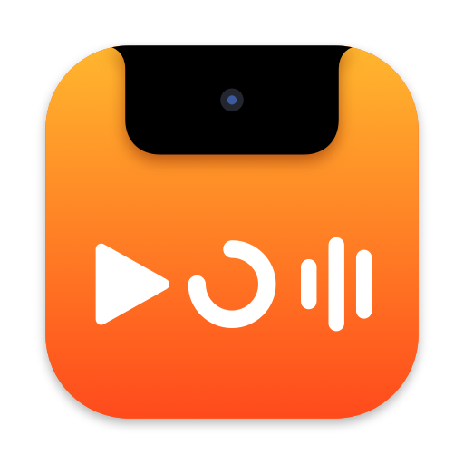
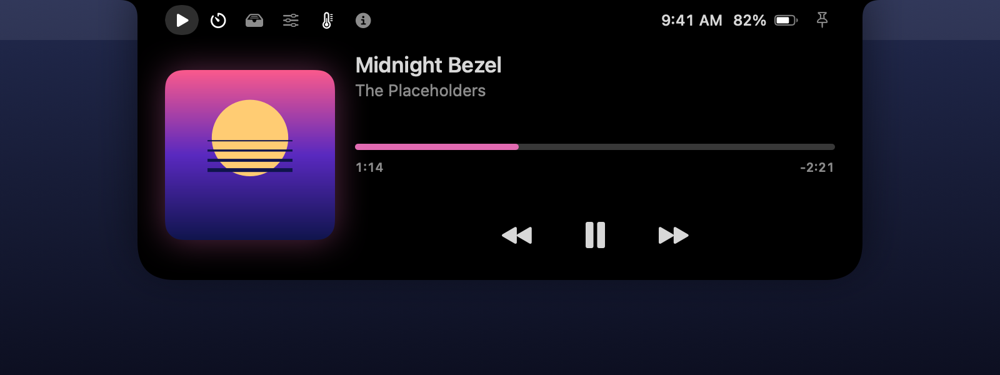
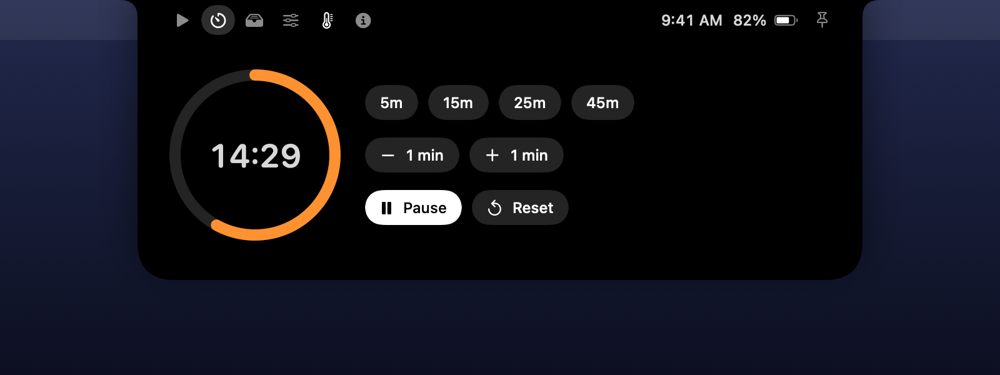
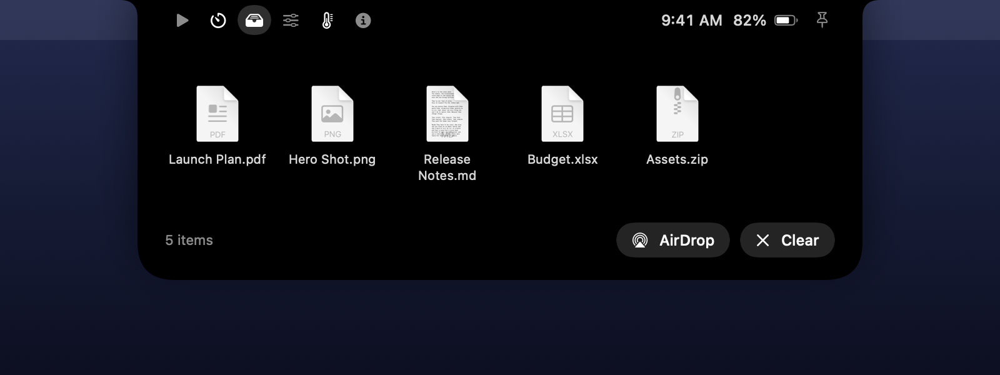
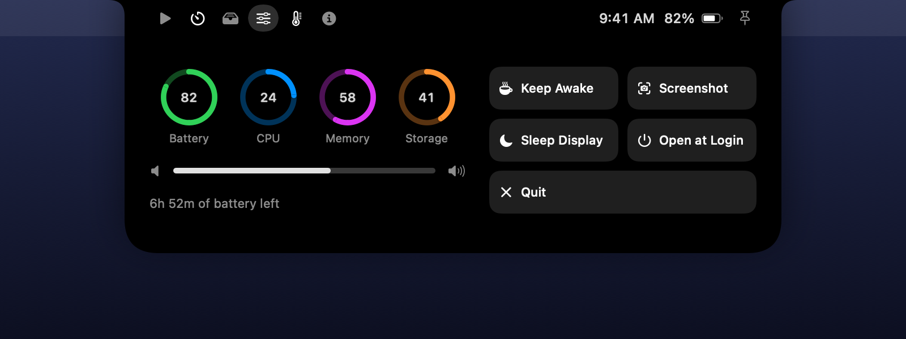
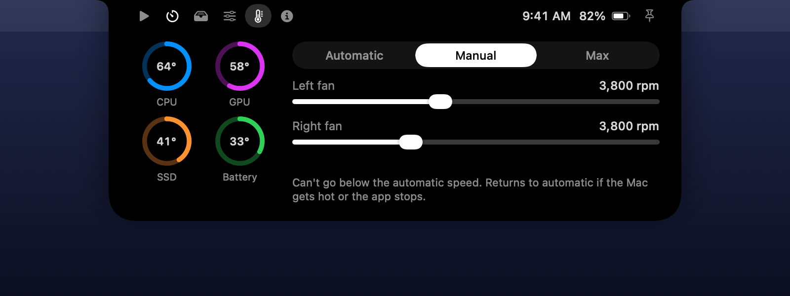

<div align="center">



# NotchUtils

**Your notch, put to work.**

Music controls, a focus timer, a file shelf, system stats and fan control, all living in your MacBook's notch.<br>
Native, lightweight and free. Hover to open, move away to close.

[](https://github.com/rupajsen/NotchUtils/releases/latest)
[](LICENSE)
[](#requirements)
[](https://github.com/rupajsen/NotchUtils/discussions/categories/ideas)


<sub>Rendered from the app's real interface with made-up data.</sub>

[**Download the latest DMG**](https://github.com/rupajsen/NotchUtils/releases/latest) · [**Suggest an idea**](https://github.com/rupajsen/NotchUtils/discussions/categories/ideas) · [**Report a bug**](https://github.com/rupajsen/NotchUtils/issues/new/choose)

</div>

## Why NotchUtils?

Your notch takes up prime space at the top of your screen and does nothing with it. NotchUtils turns it into a small control centre that stays out of the way: when nothing's happening, you won't know it's there. It also doesn't take keyboard focus, so you can pause a song or start a timer without leaving what you're typing in.

## Features

### 🎵 Now Playing
Album art, a seek bar and playback controls for **Spotify** and **Apple Music**, tinted to match the artwork.



### ⏱️ Timer
Presets from 5 to 45 minutes, ±1 minute adjustments and a progress ring. While it runs, the countdown stays visible in the closed notch.



### 📥 Shelf
Drag files onto the notch to keep them handy, then drag them out wherever they're needed or send them with AirDrop.



### 🎛️ System
Battery, CPU, memory and storage at a glance, plus a volume slider, Keep Awake, Screenshot, Sleep Display and Open at Login.



### 🌡️ Thermals
Live temperatures, plus Automatic, Manual and Max fan control on MacBook Pro models. Manual can only speed the fans up, never run them slower than macOS wanted. See [what's available on your Mac](#what-your-mac-gets) and [how it stays safe](#fan-control-safety).



### ✨ Live activity in the closed notch
The notch widens only when there's something to show: the current track, a running timer, manual fan control, a charging flash or Keep Awake.


### 🪶 And it's light
Written in Swift with SwiftUI and AppKit. No Electron, no dependencies, no analytics. It uses around 3% of one CPU core while closed with music playing (measured on an M1 Pro), and only checks what it needs while you're looking at it.

## Install

1. Download `NotchUtils-x.y.z.dmg` from the [latest release](https://github.com/rupajsen/NotchUtils/releases/latest).
2. Open it and drag **NotchUtils** to **Applications**.
3. Open NotchUtils from Applications.

### "Apple could not verify NotchUtils"

You'll probably see this the first time. NotchUtils isn't notarized yet because that requires a paid Apple Developer membership, so macOS can't vouch for it. To open it anyway:

1. Try opening the app once, then dismiss the warning.
2. Go to **System Settings → Privacy & Security**.
3. Scroll down and click **Open Anyway** next to NotchUtils.

Prefer to check first? Every release lists a SHA-256 checksum, and all the code is here to [build yourself](#build-from-source).

### Requirements

- A MacBook with a notch. All of them run Apple silicon.
- macOS 26 or later.

Developed and tested on a 14-inch MacBook Pro (M1 Pro) running macOS 27. If you try it on something else, please [tell us how it went](https://github.com/rupajsen/NotchUtils/discussions).

## Usage

| To do this | Do this |
| --- | --- |
| Open the notch | Move the pointer onto it |
| Close it | Move the pointer away |
| Keep it open | Click the pin icon |
| Add files to the Shelf | Drag them onto the notch |
| Open a Shelf file | Click it |
| Control the fans | **Thermals** tab → **Set Up Fan Control** the first time |
| Remove the fan helper | **Thermals** tab, on Automatic → trash icon |
| Quit | **System** tab → **Quit** |

The first time it sees Spotify or Music running, macOS asks whether NotchUtils may control that app. Allow it to use Now Playing. You can change this later in **System Settings → Privacy & Security → Automation**.

## What your Mac gets

NotchUtils works on MacBooks with a notch. Thermals depends on the model:

| Mac | Fans | Fan control | Temperatures |
| --- | --- | --- | --- |
| 14-inch and 16-inch MacBook Pro, M1 Pro or Max | 2 | ✅ Tested on M1 Pro | CPU, GPU, SSD, battery |
| 14-inch and 16-inch MacBook Pro, M2 Pro or Max | 2 | 🧪 Experimental | CPU, GPU, SSD, battery |
| 14-inch and 16-inch MacBook Pro, M3 or M4 family | 1 on base 14-inch, 2 on others | 🧪 Experimental | SSD, battery |
| 14-inch and 16-inch MacBook Pro, M5 family | 1 on base 14-inch, 2 on others | 🧪 Experimental | SSD, battery |
| MacBook Air, M2 | None | Not needed | CPU, GPU, SSD, battery |
| MacBook Air, M3, M4 or M5 | None | Not needed | SSD, battery |

**Experimental means we haven't been able to test it on that Mac.** Apple doesn't document fan control. On those models NotchUtils follows notes published by other developers, and it has only been checked against simulations of them. If it doesn't work, the app should say so and stay on automatic.

**Have one of these Macs?** Please [tell us how it went](https://github.com/rupajsen/NotchUtils/discussions). That's how a model moves from Experimental to tested. Temperatures are limited for the same reason: sensor names differ between chips, and a wrong label is worse than a missing one.

## Fan control safety

Changing fan speeds requires root, so fan control uses a small helper that runs in the background as a system service with administrator access. **It's optional:** nothing is installed until you click **Set Up Fan Control** and approve the macOS password prompt.

What the helper does, and doesn't do:

- It accepts only four commands (read status, check in, set a speed, return to automatic), and only from the logged-in user.
- It keeps speeds between what macOS wanted when you took over and each fan's maximum.
- It returns the fans to automatic if the app quits, crashes or stops checking in for 10 seconds, if the Mac gets hot, if macOS takes the fans back, or if the helper itself stops. The Mac going to sleep has the same effect.
- It doesn't run commands, read files or use the network.

The risks are worth understanding:

- **Manual doesn't react to load.** The fans hold the speed you set, even if macOS would have gone faster, until the temperature fallback steps in at a 95°C average. For heavy work, choose a high speed or Max, or stay on Automatic.
- **This uses undocumented hardware controls.** Apple could change how they behave in any macOS update. NotchUtils is provided without warranty, as the [license](LICENSE) says.

To remove the helper, go to the **Thermals** tab, switch to Automatic and click the trash icon.

## Privacy

NotchUtils has no accounts, analytics or telemetry. Its only network request is downloading the current track's album art from the address Spotify provides. Shelf files aren't copied or uploaded: it just remembers where they are on your Mac.

## Known limitations

- **Unsigned builds:** see the [install note](#apple-could-not-verify-notchutils). macOS may also ask for Spotify or Music access again after an update.
- **Players:** only Spotify and Apple Music for now, since macOS no longer lets third-party apps read system-wide Now Playing information.
- **Audio bars:** they're decorative and don't reflect the actual audio levels.
- **Volume slider:** it's unavailable for outputs that control their own volume, such as many HDMI and DisplayPort monitors.
- **Lid closed:** NotchUtils hides when the built-in display is off, since there's no notch to sit in.
- **Fan control:** Manual can only raise fan speeds. Models we haven't tested are marked [Experimental](#what-your-mac-gets).
- **Fan helper:** you'll be asked to update it when a new version of NotchUtils changes it.

## 💡 Got an idea? Let's make it better together

**Please feel free to add suggestions!** NotchUtils is young and your ideas will shape what it becomes. Missing a feature? Something feel off? Every suggestion is welcome, big or small. And if you have a MacBook other than an M1 Pro, trying fan control and reporting back is a big help.

- 💬 [**Share an idea**](https://github.com/rupajsen/NotchUtils/discussions/categories/ideas) in Discussions
- 🐛 [**Report a bug**](https://github.com/rupajsen/NotchUtils/issues/new/choose)
- 🛠️ **Send a pull request:** see the [contributing guide](CONTRIBUTING.md)
- ⭐ **Star the repo** if you like it, so others can find it too

A few ideas we're thinking about, none of them promised: calendar and next meeting, clipboard history, more music players, rearranging tabs, fan curves, and notarized builds.

## Build from source

You'll need macOS 26 or later and the Xcode Command Line Tools (`xcode-select --install`).

```bash
git clone https://github.com/rupajsen/NotchUtils.git
cd NotchUtils
./scripts/build.sh --install
open /Applications/NotchUtils.app
```

`./scripts/build.sh` on its own builds to `dist/NotchUtils.app` without installing. Maintainers can find the release steps in [docs/RELEASING.md](docs/RELEASING.md).

## Credits

Created by **[Rupaj Sen](https://github.com/rupajsen)**. Built with **[Claude](https://claude.com/claude-code)** Opus 5.5, by Anthropic.

## License

[MIT](LICENSE) © 2026 Rupaj Sen. See [NOTICE.md](NOTICE.md) for trademark and third-party notices.

NotchUtils is an independent project and isn't affiliated with Apple or Spotify.
